# Workflow design

This document describes the complete intended workflow for migrating one legacy resource, in one place, so that everyone works towards the same design. It summarizes; it does not replace the canonical procedures in [the step documents](workflow.md), the persistence details in [the architecture](architecture.md), or the implementation status in [the plan](implementation-plan.md). When they disagree, the step document owns the procedure and the code owns what is actually executable; fix this document.

Legend used in the diagrams: **implemented** stages are drawn with a solid border, *planned* stages with a dashed border. Planned behavior is the agreed design, not executable code. [Open questions](#open-questions) lists the parts that still need a decision. Start with [the complete workflow](#0-complete-workflow-at-a-glance); the other sections zoom into one part each.

## 0. Complete workflow at a glance

The single picture of the whole design: every stage, gate, branch, loop and way back. Numbered sections below zoom into parts of it; the zoom markers (🔍) name the section. Dashed nodes are planned.

```mermaid
flowchart TD
  %% ---------- Start and readiness ----------
  start([Owner starts the resource-migration workflow]) --> insp[00 Inspect workspace<br/>config, 4 checkouts, record, fingerprint]
  insp --> rs{Readiness status}
  rs -- blocked --> fixws[Owner fixes config,<br/>checkout or record] --> insp
  rs -- needs-initialization --> init[initialize<br/>create record v2] --> insp
  rs -- needs-upgrade --> upg[upgrade<br/>keep resource.v1.json] --> insp
  rs -- awaiting-decision --> dq
  rs -- ready-for-discovery<br/>or ready-for-target --> fresh

  %% ---------- Freshness gate, reused by every stage ----------
  fresh{Sources changed since<br/>stage evidence?}
  fresh -- yes: evidence stale --> s01
  fresh -- "no: next incomplete stage" --> route{Next stage}
  route -- 01 --> s01
  route -- 02 --> s02
  route -- 03+ --> s03

  %% ---------- Discovery and target (implemented) ----------
  subgraph D [🔍 Section 6: discovery and target - implemented]
    s01[01 Legacy discovery<br/>2 read-only agents in parallel:<br/>pages + LDAP] --> chg01{Sources changed<br/>while agents ran?}
    chg01 -- yes --> abort01[Save nothing,<br/>rerun on stable sources]
    chg01 -- no --> val01[Validate findings<br/>reject invalid for review] --> save01[Lock, save baseline, unlock]
    save01 --> sq{Scope question<br/>open?}
    sq -- no --> s02
    s02[02 Target definition<br/>1 agent: dispositions] --> val02[Validate against<br/>baseline finding IDs] --> save02[Lock, save target, unlock]
    save02 --> tq{Target question<br/>open?}
    tq -- no --> appr{Owner approves<br/>this revision?}
  end
  abort01 --> fresh
  sq -- yes --> dq
  tq -- yes --> dq
  appr -- "no: requested changes" --> rerunT[Next run regenerates<br/>target with the answer] --> s02
  appr -- approve --> s03

  %% ---------- Decision loop ----------
  subgraph Q [🔍 Section 7: decisions, pause and resume]
    dq[Pause run at<br/>decision/resource/stage/id] --> ans[Owner answers<br/>npm run answer]
    ans --> res[Resume same run<br/>reread config, record, sources]
  end
  res --> fresh

  %% ---------- Contracts and package (planned) ----------
  subgraph C [Contracts and package - planned]
    s03[03 Contracts and validation<br/>rule matrix, operations, gaps]:::planned
    s04[04 Shared package<br/>models + validators<br/>net10 + netstandard2.0]:::planned
    s05[05 API acceptance<br/>TUnit/HttpClient, final behavior,<br/>may start red]:::planned
    s03 --> s04 --> s05
  end
  s03 -. contract issue .-> s02
  s04 -. semantic ambiguity .-> dq

  %% ---------- Slice and review loop (planned) ----------
  subgraph L [🔍 Section 8: implementation loop - planned]
    pick[Pick next eligible slice]:::planned --> wl[Lock, record sources before]:::planned
    wl --> s06[06 API slice<br/>implement + meaningful tests]:::planned
    s06 --> wu[Record sources after, unlock]:::planned
    wu --> chk[Run slice checks +<br/>previously passing cases]:::planned
    chk --> cls{Each case:<br/>passed / expected-red /<br/>unexpected / infra}:::planned
    cls -- regression or changed cause --> inv[Investigate]:::planned --> s06
    cls -- infrastructure failure --> infra[Fix fixture or<br/>environment]:::planned --> chk
    cls -- slice passes --> due{3 slices since review<br/>or concrete issue?}:::planned
    due -- yes --> s07[07 Review<br/>no change is valid]:::planned
    s07 -- bounded refactor --> wl
    s07 -- nothing to change --> left
    due -- no --> left{Required slices left?}:::planned
    left -- yes --> pick
  end
  s05 --> pick
  s06 -. real contract issue .-> s03
  s06 -. missing fact changes behavior .-> dq

  %% ---------- Completion ----------
  subgraph F [Completion - planned]
    s08[08 API completion<br/>all required cases on current sources]:::planned
    s09[09 V2 integration<br/>copy pages, connect API,<br/>legacy/V2 flag]:::planned
    s10[10 Resource verification<br/>reconcile scope and evidence]:::planned
  end
  left -- no --> s08
  s08 -- any required case fails --> pick
  s08 -- exclusion or behavior change --> dq
  s08 -- all green --> s09
  s09 -- UI outcome not in target --> dq
  s09 -- API change needed --> pick
  s09 -- all interactions verified --> s10
  s10 -- evidence invalidated --> fresh
  s10 -- unagreed exclusion --> dq
  s10 -- complete --> done([Resource complete<br/>start next resource explicitly])

  %% ---------- Owner edits at any time ----------
  edit([Owner edits sources<br/>at any time]) -.-> fresh

  classDef planned stroke-dasharray: 5 5
```

How to read it:

- **Freshness gate.** Every resume and every new run passes through "Sources changed since stage evidence?". A change makes the affected evidence stale and that stage is redone; answers are kept.
- **One decision loop.** Every stage that needs the owner goes through the same pause → answer → resume path, then back through the freshness gate.
- **Ways back.** Dotted arrows reopen an earlier stage: a contract issue reopens target definition, a real contract issue found in a slice reopens contracts, a failing completion run returns to slices.
- **Where it ends today.** The implemented part stops after target approval; `inspect` then reports `ready-for-contracts`.

## 1. Scope and actors

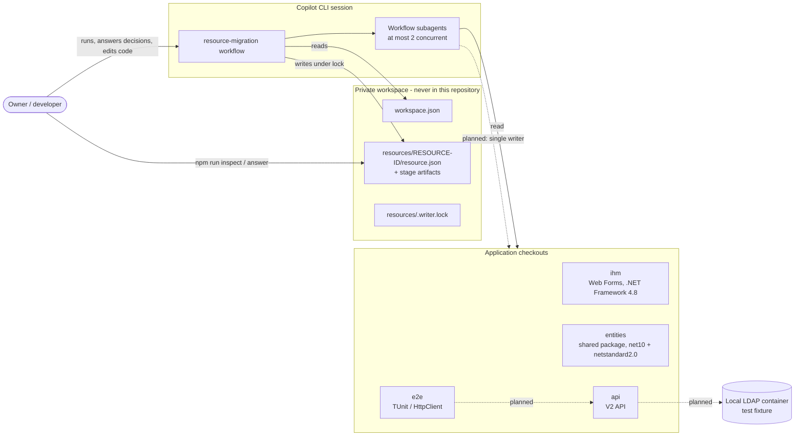

- One workspace has four checkouts with fixed roles and one private resources directory. One resource is actively migrated per workspace.
- The workflow and its agents run inside the owner's Copilot session. The CLI (`npm run ...`) offers the deterministic operations without agents.
- The owner may edit any checkout at any time. The workflow detects this through source fingerprints; it never resets the owner's work.
- Out of scope: intermediate pull requests, deployment, production rollout, Dev LDAP writes.

## 2. End-to-end stage flow

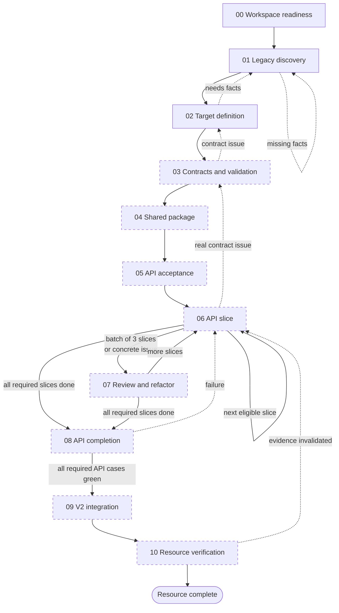

| Step | Gate to leave the step | Pauses for the owner when |
| --- | --- | --- |
| 00 | Configuration valid, four checkouts readable, record initialized (schemaVersion 2) | Never; reports `blocked` or `needs-*` instead |
| 01 | Baseline evidence current for the sources; no open scope decision | An unresolved finding affects scope |
| 02 | Owner approved this exact target revision; no open target question | A requirement needs a decision; approval of every revision |
| 03 | Every required workflow maps to an operation and scenario; rule owners verified | Contradictory rules or contract semantic changes |
| 04 | Package checks pass on both targets; consumers can use the contracts | Semantic ambiguity, dependency changes |
| 05 | All selected cases runnable and classified per case and cause | Ambiguous expected results, LDAP capability gaps |
| 06 | Slice criteria pass; previously passing cases still pass | A missing fact changes intended behavior |
| 07 | Review recorded (no-change is valid); refactor checks pass | Only for contract or business changes |
| 08 | Every required API case passes on current sources | Proposed exclusions or behavior changes |
| 09 | Every required V2 interaction verified; legacy/V2 flag works | UI outcomes not covered by target or examples |
| 10 | Required checks current; exclusions explicitly agreed | Material scope changes |

Routine work continues automatically between gates. Reviews are internal checkpoints, not human approvals.

## 3. Operations and entry points

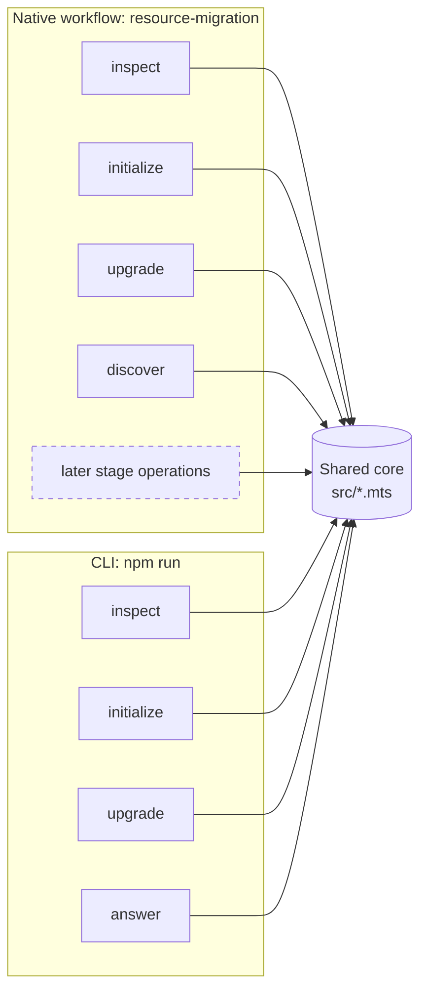

| Operation | Agents | Writes | Lock |
| --- | --- | --- | --- |
| `inspect` | No | Nothing | No |
| `initialize` | No | Creates `resource.json` only if absent (atomic hard link) | No; create-if-absent is atomic |
| `upgrade` | No | Copies v1 to `resource.v1.json`, writes v2 | Yes |
| `answer` (CLI only) | No | One decision's answer, never overwritten | Yes |
| `discover` | 2 discovery + 1 target | `discovery/`, `target/`, record | Yes, only while writing |

A single workflow with an `operation` argument is kept until per-operation arguments make the schema unwieldy.

## 4. Resource lifecycle

`inspect` derives one status from the record and the current sources:

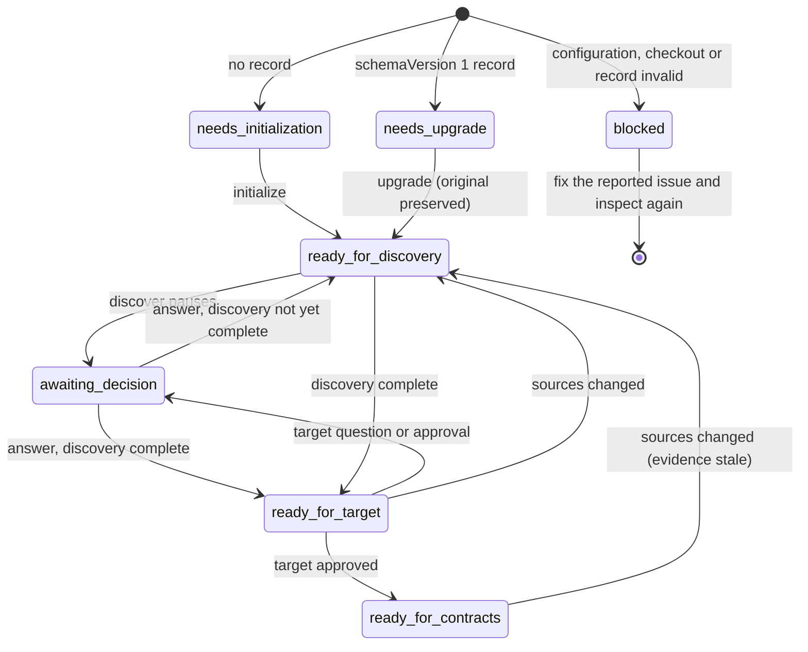

`ready_for_contracts` is where the implemented part ends today: step 03 is planned.

## 5. Stage state machine

Every stage in the record has one of four states. Transitions are a fixed table in `src/stages.mts`; agent output never selects a state.

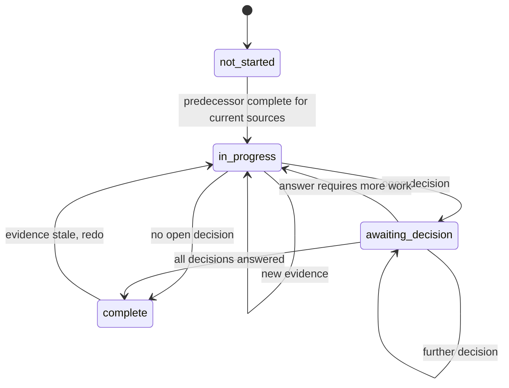

Derived, not stored:

- **Stale**: the stage's `basedOnFingerprint` differs from the current sources, or from its predecessor's.
- **Blocked**: its predecessor is not complete for the current sources.

A stage cannot start while blocked and cannot complete with an open decision.

## 6. Discovery and target definition (implemented)

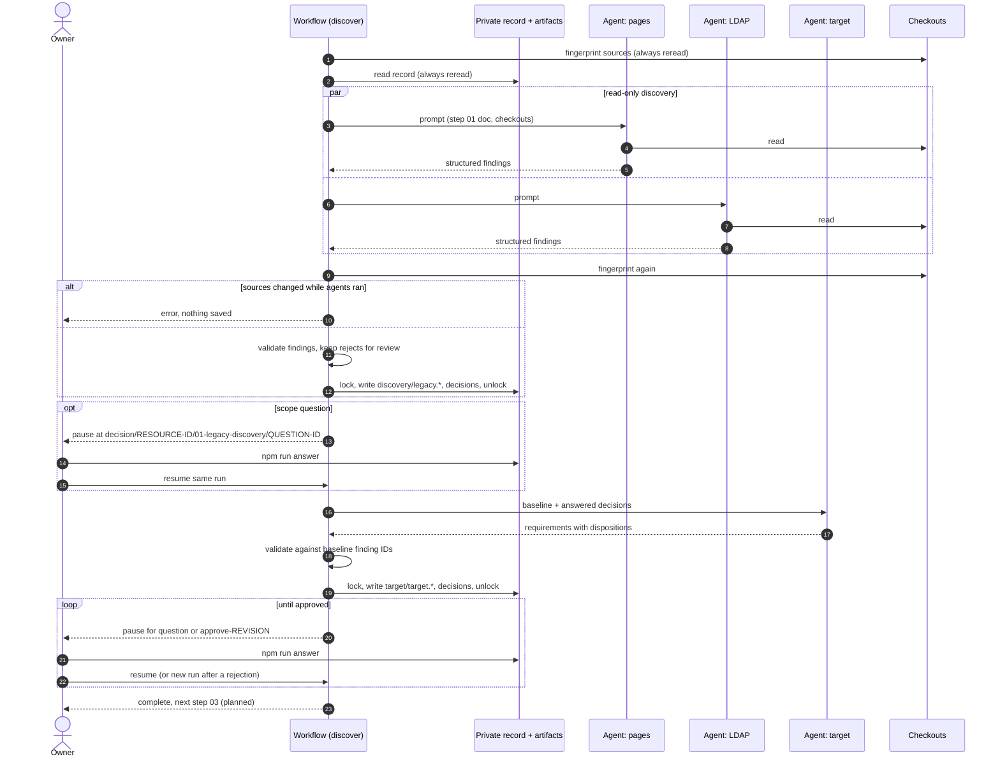

Finding classes: `observed`, `code-confirmed`, `inferred`, `unresolved`. Requirement dispositions: `preserve`, `change`, `fix`, `remove`, `question`.

## 7. Decisions, pause and resume

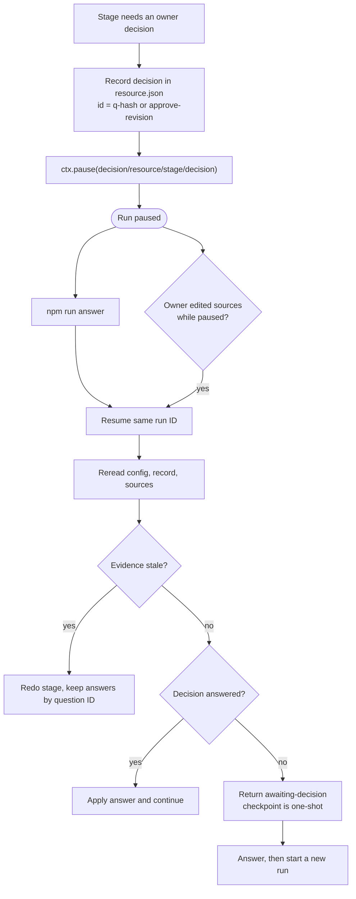

Rules:

- The resource record is authoritative. A native checkpoint only says where a run stopped.
- Configuration, record, decisions and Git state are never cached in the workflow journal.
- Agent results and validated output are cached only under keys that contain the source fingerprint.
- Answers are never overwritten. A rejected target revision is answered with requested changes; the next run uses them.

## 8. Implementation loop (planned: steps 05 to 08)

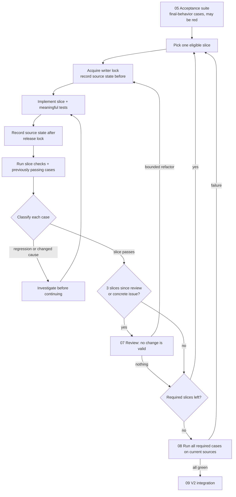

Case outcomes are tracked individually: `passed`, `expected-red` (unfinished, asserts the final result), `unexpected-failure`, `infrastructure-failure`. A count of passes or failures is never evidence on its own.

## 9. Concurrency and writes

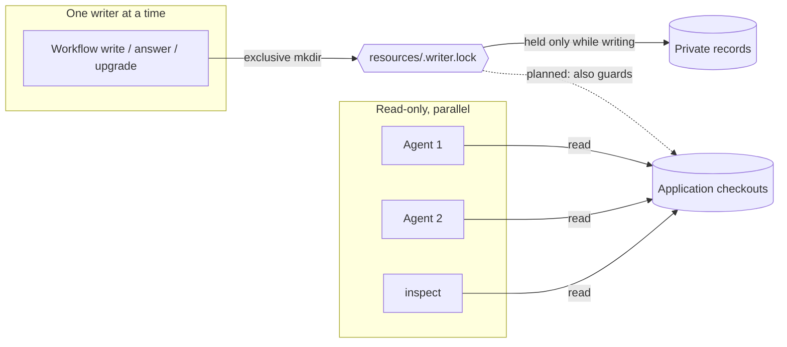

- At most two concurrent agents. Reviews read stable snapshots.
- The lock names its holder and is never broken automatically.
- Tests that mutate shared LDAP data use isolated fixtures or run serially.

## 10. Artifacts

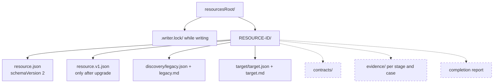

`resource.json` holds: revision, initial fingerprint, per-stage state, evidence paths and `basedOnFingerprint`, and decisions (question, source, answer, answer time).

## Open questions

These affect the design of planned stages. Answers belong in the owning step document and then here.

1. **Resource boundary.** Who defines which pages and operations belong to a resource before discovery: the owner as a workflow argument, or discovery proposing it as a scope decision (current behavior)?
2. **Runtime observation.** Should discovery observe the running legacy UI (browser or manual notes), or is source evidence enough? `observed` findings currently have no producer.
3. **Contracts format (03).** Where do contracts live and in what form: private Markdown/JSON only, or also OpenAPI or C# interfaces in the API checkout?
4. **Slice definition (06).** Is one slice one acceptance scenario, one API operation, or one rule? Who orders the slices?
5. **Acceptance results (05).** Which result format does the TUnit run emit locally (TRX, JUnit XML, console only)? The adapter must read the real output.
6. **Application commands.** What are the exact build and test commands for each checkout, on Windows and on Linux? Which of them can run on Linux at all?
7. **LDAP.** Which server and version does the local container run, and which AD-specific behaviors are needed?
8. **Review cadence (07).** Keep "every three slices", or make it configurable per resource?
9. **Commits.** Should the workflow ever create commits in application checkouts, or only leave working-tree changes for the owner?
10. **V2 verification (09).** Manual checklist, or a browser harness? Who confirms each interaction?
11. **Autonomy (increment 10).** Which owner decisions may later be automated, and which must always pause?
12. **Multiple resources.** Is "one active resource per workspace" a hard rule enforced by code, or guidance?
