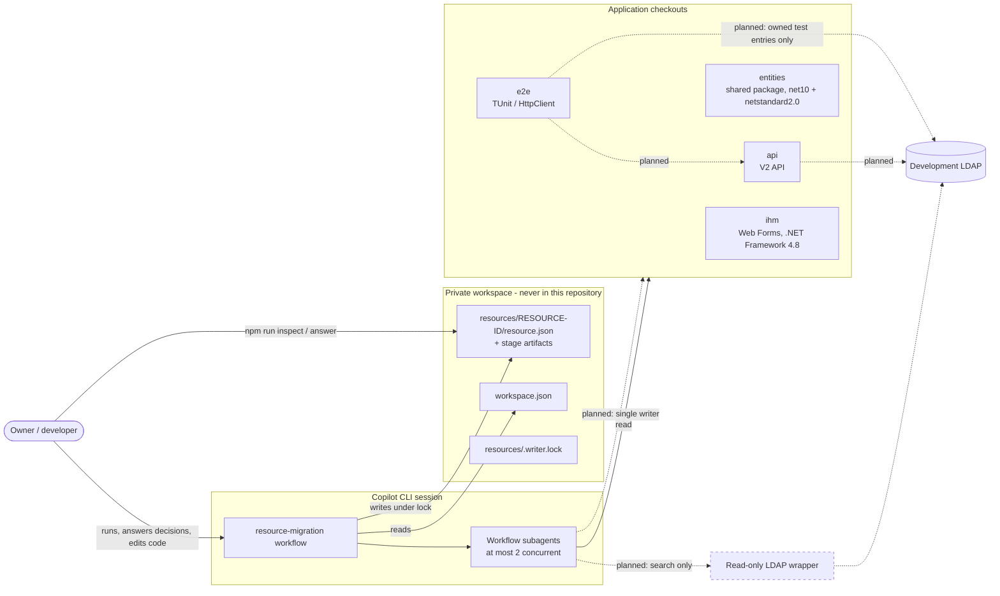
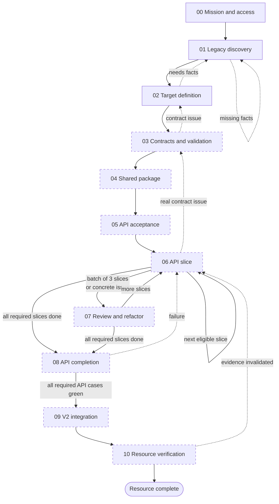
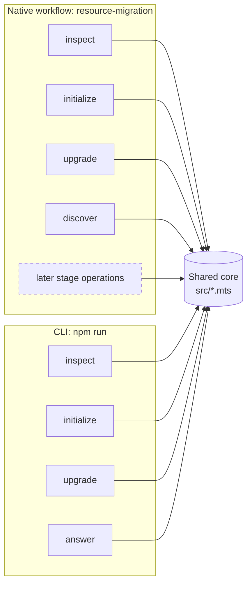
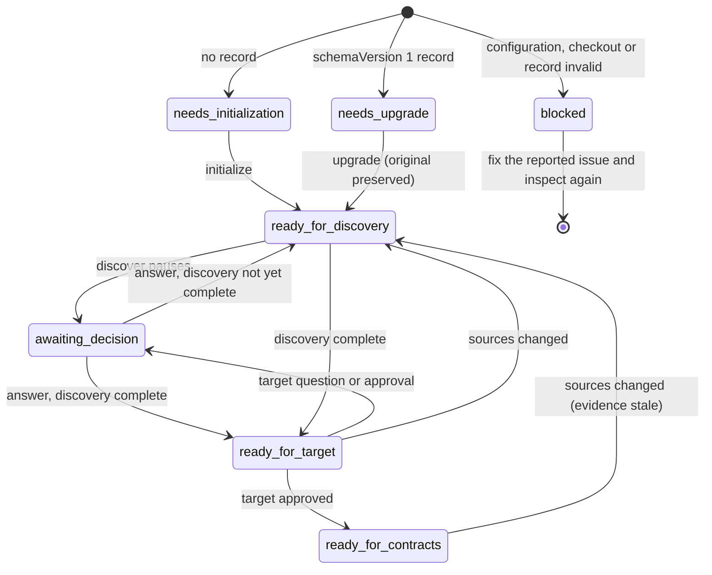
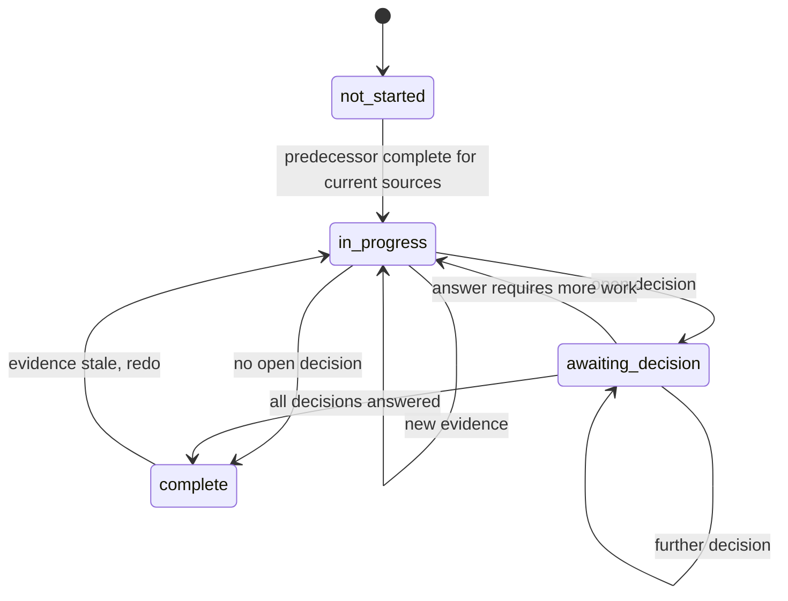
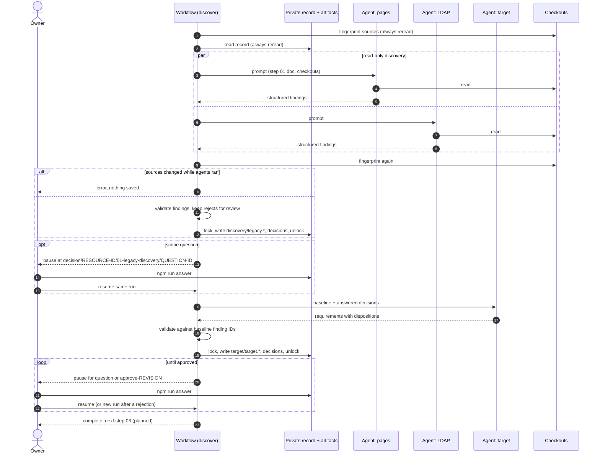
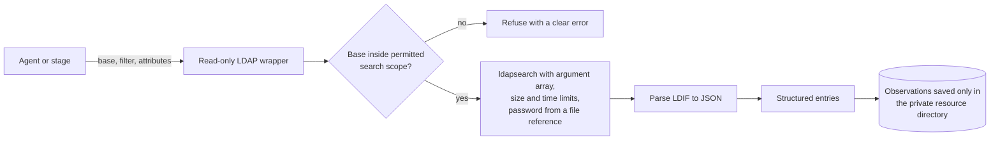
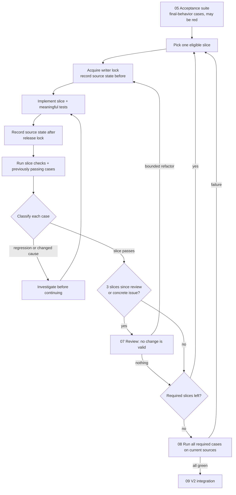
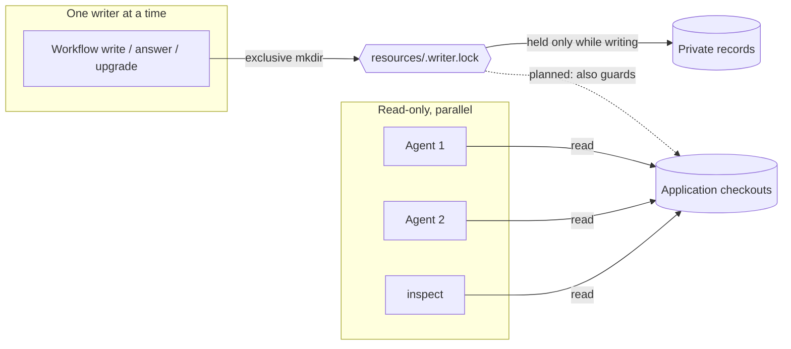
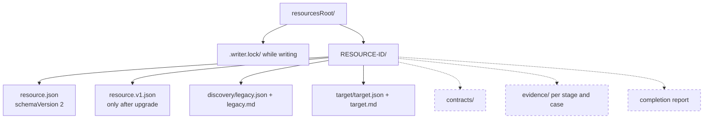

# Workflow design

This document describes the complete intended workflow for migrating one legacy resource, in one place, so that everyone works towards the same design. It summarizes; it does not replace the canonical procedures in [the step documents](workflow.md), the persistence details in [the architecture](architecture.md), or the implementation status in [the plan](implementation-plan.md). When they disagree, the step document owns the procedure and the code owns what is actually executable; fix this document.

Legend used in the diagrams: **implemented** stages are drawn with a solid border, *planned* stages with a dashed border. Planned behavior is the agreed design, not executable code. [Open questions](#open-questions) lists the parts that still need a decision. Start with [the complete workflow](#0-complete-workflow-at-a-glance); the other sections zoom into one part each.

## 0. Complete workflow at a glance

The single picture of the whole design: every stage, gate, branch, loop and way back. It is the owner's workflow; nodes drawn with a thick border (class `fix`) were added in review and are listed below. Numbered sections zoom into parts of it: [section 6](#6-discovery-and-target-definition-implemented) details S01 and S02, [section 7](#7-decisions-pause-and-resume) details SX and SB, [section 8](#8-implementation-loop-planned-steps-05-to-08) details S06 and S07.

What runs today: S00 checks configuration, checkouts and the resource record (W02, W03, W07 for source access only); S01 traces source with two read-only agents (D01–D05, D11–D13); S02 drafts and validates the target (T01–T05, T07–T10); SX pauses, records an answer and resumes. Everything else is planned. See [the implementation plan](implementation-plan.md).

```mermaid
flowchart TB
    START(["START · Migrate one resource"])
    DONE(["DONE · Resource verified within agreed scope"])

    subgraph S00["00 · Establish mission and access"]
        W01[/"W01 · INPUT: repository paths, resource brief, entry pages and requested changes"/]
        W02["W02 · Read project instructions, conventions and available tools"]
        W03["W03 · Inspect existing edits, artifacts and prior verification"]
        W04["W04 · Establish scope, authorized actions and completion criteria"]
        W05["W05 · Read real development LDAP configuration and credential references"]
        W06["W06 · Confirm development endpoint, permitted search scope and read access through the read-only LDAP wrapper"]
        W07{"W07 · Required source and directory access available?"}
        O_MISSION[/"O_MISSION · Mission, constraints, entry points and access capabilities"/]
        W08{"W08 · Existing progress for this resource?"}

        W01 --> W02 --> W03 --> W04 --> W05 --> W06 --> W07
        W07 -- Yes --> O_MISSION --> W08
    end

    subgraph S01["01 · Discover legacy behavior and actual LDAP structure"]
        D01["D01 · Inventory pages, subpages, shared controls and dependencies"]
        D02["D02 · Classify each item as in scope, external dependency or unresolved"]
        D03["D03 · Trace navigation, loads, postbacks and parent-child interactions"]
        D04["D04 · Trace defaults, conditional fields, validation and error behavior"]
        D05["D05 · Trace LDAP filters, mappings, authorization and data effects"]
        D06["D06 · Connect to the real development LDAP through the read-only wrapper"]
        D07["D07 · Inspect naming contexts, branches and available schema"]
        D08["D08 · Inspect representative entries, object classes, attributes and relationships"]
        D09["D09 · Compare actual data with application filters and mapping assumptions"]
        D10{{"D10 · YOU: observe the locally running application when necessary, from a prepared checklist"}}
        D11["D11 · Record findings, source references, LDAP observations and uncertainty"]
        D12["D12 · Check inventory coverage, contradictions and evidence validity"]
        D13{"D13 · Discovery outcome?"}
        D14["D14 · Investigate the specific remaining gap"]
        O_LEGACY[/"O_LEGACY · Versioned legacy snapshot, coverage inventory and explicit unknowns"/]
        D15{"D15 · Target already defined?"}

        D01 --> D02 --> D03 --> D04 --> D05 --> D06
        D06 --> D07 --> D08 --> D09 --> D10 --> D11 --> D12 --> D13
        D13 -- Accessible evidence remains --> D14 --> D01
        D13 -- Sufficient evidence for target review --> O_LEGACY --> D15
    end

    subgraph S02["02 · Define and validate the V2 target"]
        T01["T01 · Read legacy findings, requested changes and existing V2 conventions"]
        T02["T02 · Assign preserve, change, fix or remove to each scoped behavior"]
        T03["T03 · Specify expected outcomes, UI behavior and exclusions"]
        T04["T04 · Map legacy pages and interactions to proposed V2 pages and interactions"]
        T05["T05 · Expose UI mismatches and propose concrete resolutions"]
        T06["T06 · Prepare examples or mockups for consequential UI changes"]
        T07["T07 · Link requirements to evidence and identify unresolved decisions"]
        T08["T08 · Check target consistency and coverage"]
        T09{{"T09 · YOU: validate V2 behavior, UI differences and exclusions"}}
        T10{"T10 · Human review outcome?"}
        T11["T11 · Revise the affected target proposal"]
        O_TARGET[/"O_TARGET · Human-validated target revision, requirement IDs and decisions"/]
        T12{"T12 · Contracts already defined?"}

        T01 --> T02 --> T03 --> T04 --> T05 --> T06 --> T07 --> T08 --> T09 --> T10
        T10 -- Changes requested --> T11 --> T02
        T10 -- Validated --> O_TARGET --> T12
    end

    subgraph S03["03 · Define and validate API contracts and functional slices"]
        C01["C01 · Map validated target journeys to API operations"]
        C02["C02 · Inspect existing API, shared package and consumer capabilities"]
        C03["C03 · Define inputs, outputs, defaults, errors and side effects"]
        C04["C04 · Define create, update and child-validation matrix"]
        C05["C05 · Assign rule ownership across package and API layers"]
        C06["C06 · Identify reusable, extendable and missing capabilities"]
        C07["C07 · Define functional slices with outcomes, boundaries and dependencies"]
        C08["C08 · Link each slice to requirements and final-behavior acceptance scenarios"]
        C09["C09 · Prepare example requests, responses and failure cases"]
        C10["C10 · Check consistency across contracts, rules and slice boundaries"]
        C11{{"C11 · YOU: validate API definition and functional slices"}}
        C12{"C12 · Human review outcome?"}
        C13["C13 · Revise affected contracts or slice definitions"]
        O_CONTRACTS[/"O_CONTRACTS · Human-validated contracts, rule matrix and functional slice plan"/]
        C14{"C14 · Downstream work already exists?"}

        C01 --> C02 --> C03 --> C04 --> C05 --> C06
        C06 --> C07 --> C08 --> C09 --> C10 --> C11 --> C12
        C12 -- Changes requested --> C13 --> C03
        C12 -- Validated --> O_CONTRACTS --> C14
    end

    subgraph S04["04 · Prepare shared entities and validators"]
        P01["P01 · Compare validated models and rules with the existing package"]
        P02{"P02 · Package changes needed?"}
        P03["P03 · Implement bounded model and validator changes"]
        P04["P04 · Add meaningful tests for changed rules and boundaries"]
        P05["P05 · Build required targets and check affected consumer compatibility"]
        P06{"P06 · Verification outcome?"}
        O_PACKAGE[/"O_PACKAGE · Verified package revision or verified existing capability"/]

        P01 --> P02
        P02 -- Yes --> P03 --> P04 --> P05
        P02 -- No --> P05
        P05 --> P06
        P06 -- Implementation defect --> P03
        P06 -- Verified --> O_PACKAGE
    end

    subgraph S05["05 · Establish API acceptance against real development LDAP"]
        E01["E01 · Inspect existing TUnit and HttpClient harness conventions"]
        E02["E02 · Configure API and tests for the real development LDAP"]
        E03["E03 · Identify existing read dependencies and necessary test mutations"]
        E04{"E04 · Required test writes already authorized?"}
        E05["E05 · Define owned test entries, isolation, setup and cleanup"]
        E06["E06 · Implement scenarios asserting final intended behavior"]
        E07["E07 · Build, discover and execute required scenarios"]
        E08["E08 · Check owned-data cleanup and account for residual test data"]
        E09{"E09 · Execution complete and trustworthy?"}
        E10["E10 · Repair missing cases, test defects or harness defects"]
        E11["E11 · Classify every case and record its specific failure cause"]
        E12["E12 · Compare unmet requirements with current implementation"]
        E13["E13 · Split validated functional slices into bounded technical tasks"]
        E14["E14 · Record task criteria, dependencies and protecting checks"]
        O_PLAN[/"O_PLAN · Acceptance baseline and requirement-linked technical task queue"/]

        E01 --> E02 --> E03 --> E04
        E04 -- Yes or no writes needed --> E05 --> E06 --> E07 --> E08 --> E09
        E09 -- Test or harness defect --> E10 --> E06
        E09 -- Yes --> E11 --> E12 --> E13 --> E14 --> O_PLAN
    end

    subgraph S06["06 · Implement and verify one API task"]
        A01["A01 · Refresh current source, task dependencies, unblock conditions and verification baseline"]
        A02{"A02 · Remaining required work?"}
        A03["A03 · Select one eligible functional or refactoring task"]
        A04["A04 · Inspect affected entities, validators, presenters, core and gateways"]
        A05["A05 · Confirm task stays within validated contract and slice boundaries"]
        A06["A06 · Implement the smallest coherent change with meaningful tests"]
        A07["A07 · Run task checks and relevant regression checks"]
        A08["A08 · Compare results and failure causes with the recorded baseline"]
        A09{"A09 · Verification outcome?"}
        A10["A10 · Diagnose implementation failure and revise the change"]
        A11["A11 · Repair a demonstrated test or fixture defect"]
        O_SLICE[/"O_SLICE · Verified task, current case results and remaining work"/]

        A01 --> A02
        A02 -- Eligible work exists --> A03 --> A04 --> A05 --> A06 --> A07 --> A08 --> A09
        A09 -- Implementation failure --> A10 --> A06
        A09 -- Test or fixture defect --> A11 --> A07
        A09 -- Criteria pass and protected behavior holds --> O_SLICE
    end

    subgraph S07["07 · Review accumulated design and refactor"]
        R01{"R01 · Three functional slices completed since last review, or concrete design issue?"}
        R02["R02 · Review accumulated changes and adjacent responsibilities"]
        R03["R03 · Assess duplication, coupling, complexity and rule ownership"]
        R04{"R04 · Review outcome?"}
        R05["R05 · Define bounded refactoring tasks with protecting checks"]
        R06["R06 · Schedule improvements before dependent work"]
        R07["R07 · Record review rationale and refresh review cadence"]
        O_REVIEW[/"O_REVIEW · Review outcome and any queued refactoring tasks"/]

        R01 -- Yes --> R02 --> R03 --> R04
        R04 -- Behavior-preserving improvement --> R05 --> R06 --> R07
        R04 -- No justified change --> R07
        R07 --> O_REVIEW
    end

    subgraph S08["08 · Verify complete API behavior"]
        F01["F01 · Review cross-slice consistency and requirement coverage"]
        F02{"F02 · Further implementation or justified refactoring needed?"}
        F03["F03 · Create or reopen tasks with concrete acceptance criteria"]
        F04["F04 · Execute every required resource API scenario"]
        F05["F05 · Account for every case and verify test-data cleanup"]
        F06{"F06 · All required cases pass on current source?"}
        F07["F07 · Classify failures, missing coverage and unavailable checks"]
        O_API[/"O_API · Complete API coverage and current passing evidence"/]

        F01 --> F02
        F02 -- Yes --> F03
        F02 -- No --> F04 --> F05 --> F06
        F06 -- No --> F07
        F06 -- Yes --> O_API
    end

    subgraph S09["09 · Create and integrate V2 pages"]
        U01["U01 · Read validated UI target, page inventory and current API contracts"]
        U02["U02 · Inspect existing V2 copies and preserve valid work"]
        U03{"U03 · Required V2 copies complete?"}
        U04["U04 · Fully duplicate missing scoped pages with V2 suffixes"]
        U05["U05 · Adjust code-behind, designers, directives and references"]
        U18["U18 · Build the legacy solution with the V2 copies"]
        U06["U06 · Register every new V2 page in the existing feature-flag mechanism"]
        U07["U07 · Plan requirement-linked interaction tasks"]
        U08{"U08 · Remaining UI work, after rechecking blocked tasks?"}
        U09["U09 · Connect one interaction through the established API pattern"]
        U10{{"U10 · YOU: verify results, state, postbacks, validation and error display from a prepared checklist"}}
        U11{"U11 · Interaction outcome?"}
        U12["U12 · Repair UI implementation"]
        U13["U13 · Record verified interaction"]
        U14{{"U14 · YOU: verify complete journeys, navigation and parent-child behavior"}}
        U15{{"U15 · YOU: verify legacy and V2 feature-flag routing"}}
        U16{"U16 · Complete UI verification outcome?"}
        U17["U17 · Create or reopen affected UI tasks"]
        O_UI[/"O_UI · Integrated V2 pages and current journey evidence"/]

        U01 --> U02 --> U03
        U03 -- No --> U04 --> U05 --> U18 --> U06
        U03 -- Yes --> U06
        U06 --> U07 --> U08
        U08 -- Eligible task exists --> U09 --> U10 --> U11
        U11 -- UI defect --> U12 --> U09
        U11 -- Verified --> U13 --> U08
        U08 -- No required work remains --> U14 --> U15 --> U16
        U16 -- UI defect or missing coverage --> U17 --> U08
        U16 -- Verified --> O_UI
    end

    subgraph S10["10 · Reconcile and complete the resource"]
        V01["V01 · Map every target requirement to implementation and verification"]
        V02["V02 · Check package, API and UI evidence against current revisions"]
        V03["V03 · Validate required artifacts and their supporting evidence"]
        V04["V04 · Check unresolved questions and explicitly agreed exclusions"]
        V05{"V05 · Resource completion outcome?"}
        V06["V06 · Correct documentation and traceability"]
        V07["V07 · Finalize target and implementation documentation"]
        V08["V08 · Preserve historical legacy snapshots and decision history"]
        O_REPORT[/"O_REPORT · Delivered scope, verified revisions, results, exclusions and limitations"/]

        V01 --> V02 --> V03 --> V04 --> V05
        V05 -- Documentation only --> V06 --> V01
        V05 -- All criteria satisfied --> V07 --> V08 --> O_REPORT
    end

    subgraph SX["Shared subroutine · Investigate uncertainty and obtain decisions"]
        X01["X01 · Record the question, affected work and continuation point"]
        X02["X02 · Investigate available source, LDAP evidence, conventions and bounded experiments"]
        X03{"X03 · Resolution type?"}
        X04["X04 · Record evidence-backed technical resolution"]
        X05["X05 · Prepare concrete options, implications and a recommendation"]
        X06{{"X06 · YOU: resolve consequential ambiguity or grant missing authority"}}
        X07["X07 · Record the answer and affected scope or revision"]

        X01 --> X02 --> X03
        X03 -- Within validated scope and authority --> X04
        X03 -- Human decision or authority needed --> X05 --> X06
        X06 -- Answered --> X07
    end

    subgraph SB["Shared subroutine · Recover, continue independent work or pause"]
        B01["B01 · Diagnose access, environment, dependencies or repeated failure"]
        B02{"B02 · Safe remedy within authority and retry budget?"}
        B03["B03 · Apply a bounded remedy and verify its effect"]
        B04{"B04 · Blocker resolved?"}
        B05["B05 · Record blocker, attempted remedies and unblock conditions"]
        B06{"B06 · Independent authorized work available?"}
        B07["B07 · Select eligible work while retaining the blocked gate"]
        PAUSED(["PAUSED · Required work awaits recorded unblock conditions"])
        BUDGET["RULE · Every automatic repair loop has a retry budget; a spent budget goes to B01"]

        B01 --> B02
        B02 -- Yes --> B03 --> B04
        B04 -- No --> B05
        B02 -- No --> B05
        B05 --> B06
        B06 -- Yes --> B07
        B06 -- No --> PAUSED
        BUDGET -.-> B01
    end

    subgraph SI["Shared subroutine · Assess impact and resume affected work"]
        I01["I01 · Compare changed source, scope, decisions, artifacts and LDAP assumptions"]
        I02["I02 · Trace affected requirements, contracts, tasks and checks"]
        I03["I03 · Mark affected evidence stale and preserve unrelated valid work"]
        I04["I04 · Create or reopen tasks and update dependencies"]
        I05{"I05 · Human-validated definition affected and not yet revalidated?"}
        I06["I06 · Retain applicable validations and choose earliest affected work"]
        I07{"I07 · Resume at the saved continuation point, else the earliest affected stage"}

        I01 --> I02 --> I03 --> I04 --> I05
        I05 -- No --> I06 --> I07
    end

    START --> W01
    W07 -- Missing scope or authority --> X01
    W07 -- Access or environment blocked --> B01
    W08 -- No --> D01
    W08 -- Yes --> I01

    D13 -- Scope or consequential interpretation unresolved --> X01
    D13 -- Required evidence inaccessible --> B01
    D15 -- No --> T01
    D15 -- Yes --> I01

    T10 -- Missing legacy evidence --> D14
    T10 -- Decision deferred --> B05
    T12 -- No --> C01
    T12 -- Yes --> I01

    C12 -- Target or UI mismatch --> T11
    C12 -- Missing legacy evidence --> D14
    C12 -- Decision deferred --> B05
    C14 -- No --> P01
    C14 -- Yes --> I01

    P06 -- Contract issue --> I01
    P06 -- Environment blocked --> B01
    O_PACKAGE --> E01

    E04 -- No --> X01
    E09 -- Environment or cleanup blocked --> B01
    E09 -- Contract ambiguity --> X01
    O_PLAN --> A01

    A02 -- All remaining work blocked --> B01
    A02 -- No required tasks remain --> F01
    A05 -- Definition change required --> I01
    A09 -- Target or contract defect --> I01
    A09 -- Environment blocked or no progress --> B01
    O_SLICE --> R01

    R01 -- No --> A01
    R04 -- Behavior or API definition must change --> I01
    O_REVIEW --> A01

    F03 --> A01
    F07 -- Implementation defect --> F03
    F07 -- Missing or defective scenarios --> E06
    F07 -- Environment or cleanup blocked --> B01
    F07 -- Target or contract defect --> I01
    O_API --> U01

    U06 -- Registration not authorized --> X01
    U08 -- All remaining work blocked --> B01
    U11 -- API or contract defect --> I01
    U11 -- Intended UI behavior unclear --> X01
    U11 -- Verification blocked --> B01
    U16 -- API, contract or target defect --> I01
    U16 -- Verification blocked --> B01
    O_UI --> V01

    V05 -- Missing work or stale evidence --> I01
    V05 -- Consequential decision unresolved --> X01
    V05 -- Required verification blocked --> B01
    O_REPORT --> DONE

    X04 --> I01
    X07 --> I01
    X06 -- Deferred --> B05
    X03 -- Required evidence inaccessible --> B01
    X03 -- Validated target or API definition must change --> I01

    B04 -- Yes --> I01
    B07 --> I07
    PAUSED -- Access, evidence or decision supplied --> I01

    I05 -- V2 behavior, UI or exclusions --> T01
    I05 -- API semantics or functional slice boundaries --> C01

    I07 -- Mission or access --> W02
    I07 -- Legacy evidence --> D01
    I07 -- Target proposal --> T01
    I07 -- Contracts or slice proposal --> C01
    I07 -- Shared package --> P01
    I07 -- Acceptance setup or scenarios --> E01
    I07 -- API tasks --> A01
    I07 -- Design review --> R01
    I07 -- Complete API verification --> F01
    I07 -- V2 integration --> U01
    I07 -- Resource completion --> V01

    classDef fix stroke-width:4px
    class W06,W08,D06,D10,D15,T12,C14,A01,R01,U06,U08,U10,U14,U15,U18,X06,BUDGET,I05,I07 fix
```

How to read it:

- **Stages** S00 to S10 match the [step documents](workflow.md) 00 to 10. Each ends in an output (`O_…`) that the next stage consumes. Hexagons marked **YOU** are owner actions.
- **Three shared subroutines** replace repeated arrows. SX investigates a question and, when needed, asks the owner. SB recovers from a blocker, continues independent work or pauses. SI assesses the impact of any change (owner edits, answers, new evidence, redefinitions) and resumes the earliest affected work, keeping still-valid validations.
- **Every resumed or repeated run goes through SI** (W08, D15, T12, C14). Revalidating one definition therefore never silently redoes later work: SI traces what the change affects and keeps the rest.
- **Retry budgets.** Automatic repair loops (D14, P03, E10, A10, A11, U12) stop when their budget is spent and go to SB.
- **Runtime checks are manual for now.** The application can run locally, but D10, U10, U14 and U15 are owner checks from a prepared checklist; browser automation may be designed later.

Changes made in review, highlighted with a thick border:

| Node | Change | Reason |
| --- | --- | --- |
| W08 | "Existing progress?" after O_MISSION, Yes → I01 | A rerun or a resume after owner edits must not restart discovery |
| D15, T12, C14 | "Already defined / downstream work exists?" after O_LEGACY, O_TARGET, O_CONTRACTS, Yes → I01 | Reopened discovery, target or contracts keep unaffected later work instead of redoing everything downstream |
| I05 | "…and not yet revalidated" | Prevents looping back after a definition has just been revalidated |
| X06 | "Deferred" exit to B05 | The owner can defer any question, not only the target and contract reviews |
| R01 | Counts functional slices completed since last review | A slice completes when all its tasks are verified; refactoring tasks do not count |
| BUDGET | One rule for all automatic repair loops | Bounds otherwise unbounded loops |
| A01, U08 | Recheck unblock conditions | Work set aside by B07 resumes when its blocker clears |
| I07 | Saved continuation point; Design review | X01 records an exact continuation point; review was unreachable on resume |
| W06, D06 | Through the read-only LDAP wrapper | See [section 7a](#7a-ldap-access) |
| D10, U10, U14, U15 | Owner checks from a prepared checklist | No UI automation yet |
| U18 | Build after duplicating pages | Catches broken copies before registration |
| U06 | Register new pages in the existing feature flag; exit to X01 | The flag mechanism exists, but every new page must be registered |
| U16 | Merged two exits that both went to I01 | Simplification |

## 1. Scope and actors



- One workspace has four checkouts with fixed roles and one private resources directory. One resource is actively migrated per workspace.
- The workflow and its agents run inside the owner's Copilot session. The CLI (`npm run ...`) offers the deterministic operations without agents.
- The owner may edit any checkout at any time. The workflow detects this through source fingerprints; it never resets the owner's work.
- The development LDAP is read through the read-only wrapper ([section 7a](#7a-ldap-access)). Acceptance tests may write only owned test entries, after the owner authorizes them (E04), and clean them up.
- The legacy application can run locally. Runtime checks (D10, U10, U14, U15) are owner checks from a prepared checklist; browser automation may be designed later.
- Out of scope: intermediate pull requests, deployment, production rollout, any other development LDAP write.

## 2. End-to-end stage flow



| Step | Gate to leave the step | Pauses for the owner when |
| --- | --- | --- |
| 00 | Configuration valid, four checkouts readable, record initialized (schemaVersion 2); planned: LDAP read access confirmed | Missing scope or authority (planned); today reports `blocked` or `needs-*` instead |
| 01 | Baseline evidence current for the sources; no open scope decision | An unresolved finding affects scope |
| 02 | Owner approved this exact target revision; no open target question | A requirement needs a decision; approval of every revision |
| 03 | Every required workflow maps to an operation and scenario; rule owners verified | Contradictory rules or contract semantic changes |
| 04 | Package checks pass on both targets; consumers can use the contracts | Semantic ambiguity, dependency changes |
| 05 | All selected cases runnable and classified per case and cause | Ambiguous expected results, LDAP capability gaps |
| 06 | Slice criteria pass; previously passing cases still pass | A missing fact changes intended behavior |
| 07 | Review recorded (no-change is valid); refactor checks pass | Only for contract or business changes |
| 08 | Every required API case passes on current sources | Proposed exclusions or behavior changes |
| 09 | Every required V2 interaction verified; legacy/V2 flag works | UI outcomes not covered by target or examples |
| 10 | Required checks current; exclusions explicitly agreed | Material scope changes |

Routine work continues automatically between gates. Reviews are internal checkpoints, not human approvals.

## 3. Operations and entry points



| Operation | Agents | Writes | Lock |
| --- | --- | --- | --- |
| `inspect` | No | Nothing | No |
| `initialize` | No | Creates `resource.json` only if absent (atomic hard link) | No; create-if-absent is atomic |
| `upgrade` | No | Copies v1 to `resource.v1.json`, writes v2 | Yes |
| `answer` (CLI only) | No | One decision's answer, never overwritten | Yes |
| `discover` | 2 discovery + 1 target | `discovery/`, `target/`, record | Yes, only while writing |

A single workflow with an `operation` argument is kept until per-operation arguments make the schema unwieldy.

## 4. Resource lifecycle

`inspect` derives one status from the record and the current sources:



`ready_for_contracts` is where the implemented part ends today: step 03 is planned.

## 5. Stage state machine

Every stage in the record has one of four states. Transitions are a fixed table in `src/stages.mts`; agent output never selects a state.



Derived, not stored:

- **Stale**: the stage's `basedOnFingerprint` differs from the current sources, or from its predecessor's.
- **Blocked**: its predecessor is not complete for the current sources.

A stage cannot start while blocked and cannot complete with an open decision.

## 6. Discovery and target definition (implemented)

Zoom of S01 and S02 in [section 0](#0-complete-workflow-at-a-glance), as implemented today: source tracing only (D01–D05, D11–D13). LDAP inspection (D06–D09) and owner runtime observation (D10) are planned.



Finding classes: `observed`, `code-confirmed`, `inferred`, `unresolved`. Requirement dispositions: `preserve`, `change`, `fix`, `remove`, `question`.

## 7. Decisions, pause and resume

Zoom of SX, and of PAUSED in SB, in [section 0](#0-complete-workflow-at-a-glance), as implemented for discovery and target decisions.


Rules:

- The resource record is authoritative. A native checkpoint only says where a run stopped.
- Configuration, record, decisions and Git state are never cached in the workflow journal.
- Agent results and validated output are cached only under keys that contain the source fingerprint.
- Answers are never overwritten. A rejected target revision is answered with requested changes; the next run uses them.

## 7a. LDAP access

Planned. The workflow and its agents never call the LDAP command line directly. A small wrapper, owned by this repository, exposes only search:



- **Why a wrapper rather than direct CLI calls.** It can only search, so writes are impossible by construction rather than by convention. It enforces the permitted search scope from W06, size and time limits, and credentials given only as references (a password file or environment variable, never in arguments, prompts or artifacts). Output is structured and reproducible, and errors are explicit, as for Git today.
- **Backend.** `ldapsearch` (OpenLDAP client) is the default. If it is not available on Windows, the same interface can use a Node LDAP client instead; the choice stays inside the wrapper.
- **Account.** A read-only account is still preferred; the wrapper does not replace it.
- **Writes.** Acceptance-test writes (S05) go through the test harness, not the wrapper.

## 8. Implementation loop (planned: steps 05 to 08)

Zoom of S05 to S08 in [section 0](#0-complete-workflow-at-a-glance). In the overview, slices are split into tasks (E13) and S06 verifies one task at a time; a slice is complete when all its tasks are verified.



Case outcomes are tracked individually: `passed`, `expected-red` (unfinished, asserts the final result), `unexpected-failure`, `infrastructure-failure`. A count of passes or failures is never evidence on its own.

## 9. Concurrency and writes



- At most two concurrent agents. Reviews read stable snapshots.
- The lock names its holder and is never broken automatically.
- Tests that mutate the development LDAP touch only owned test entries (E05), once authorized (E04), and run serially.

## 10. Artifacts



`resource.json` holds: revision, initial fingerprint, per-stage state, evidence paths and `basedOnFingerprint`, and decisions (question, source, answer, answer time).

## Open questions

These affect the design of planned stages. Answers belong in the owning step document and then here.

Answered:

- **Resource boundary.** The owner gives the resource brief and entry pages (W01); discovery classifies everything it finds as in scope, external dependency or unresolved (D02).
- **Slice definition.** The owner validates functional slices with the contracts (C11); acceptance splits them into technical tasks (E13).
- **Runtime observation and V2 verification.** The application runs locally; observation and UI verification are owner checks from a prepared checklist for now (D10, U10, U14, U15).
- **LDAP access.** Through a small read-only wrapper; see [section 7a](#7a-ldap-access).
- **Feature flag.** The mechanism exists; every new V2 page must be registered in it (U06).

Still open:

1. **Test-write authorization (E04).** Proposed default: authorize once per resource for a named owned subtree or naming prefix, recorded as a decision with the cleanup rule; any write outside it needs a new decision. Is that acceptable?
2. **Contracts format (03).** Where do contracts live and in what form: private Markdown/JSON only, or also OpenAPI or C# interfaces in the API checkout?
3. **Acceptance results (05).** Which result format does the TUnit run emit locally (TRX, JUnit XML, console only)? The adapter must read the real output.
4. **Application commands.** What are the exact build and test commands for each checkout, on Windows and on Linux? Which of them can run on Linux at all?
5. **LDAP server.** Which server and version is the development LDAP, and which AD-specific behaviors are needed? Is `ldapsearch` available on the Windows machine?
6. **Retry budgets.** How many automatic attempts per repair loop before going to SB? Proposed: three, and immediately on a repeated identical failure.
7. **Review cadence (07).** Keep "every three functional slices", or make it configurable per resource?
8. **Commits.** Should the workflow ever create commits in application checkouts, or only leave working-tree changes for the owner?
9. **Autonomy (increment 10).** Which owner decisions may later be automated, and which must always pause?
10. **Multiple resources.** Is "one active resource per workspace" a hard rule enforced by code, or guidance?
